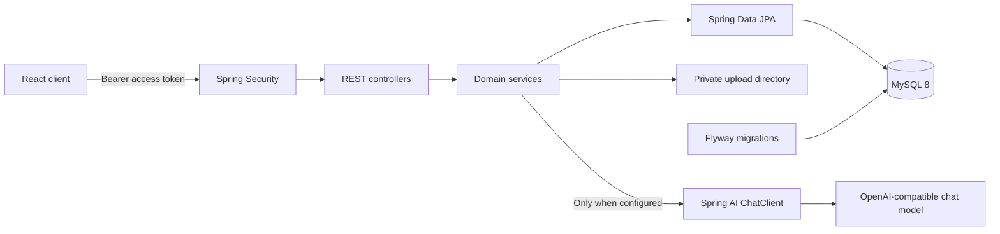

# Hireflow Backend

Secure REST API for the AI-Assisted Internship Application Tracker. The project uses Java 21, Spring Boot 4, Spring Security JWT, Spring Data JPA, MySQL 8, Flyway, and optional Spring AI.

## Architecture



Controllers handle HTTP and validation. Services own business rules and user scoping. Repositories provide persistence. `CurrentUserService` derives ownership from the verified JWT, never from request data. Lookups use user-scoped repository methods; known foreign-owned IDs return 403, while absent IDs return 404.

## Prerequisites

- JDK 21
- Docker Desktop with Compose, or MySQL 8
- Maven Wrapper is included

## Local setup

Copy `.env.example` to `.env` and replace the local passwords and `JWT_SECRET`. The backend imports `.env` when started from the `backend` directory. `.env` is ignored by Git; never commit it or put production secrets in `.env.example`.

| Variable                   | Example                                   | Purpose                                     |
| -------------------------- | ----------------------------------------- | ------------------------------------------- |
| `DB_URL`                   | `jdbc:mysql://localhost:3306/hireflow_db` | MySQL JDBC URL                              |
| `DB_USERNAME`              | `hireflow_user`                           | Database account                            |
| `DB_PASSWORD`              | Set a local password                      | Database password                           |
| `JWT_SECRET`               | At least 32 random characters             | HS256 signing key                           |
| `GEMINI_API_KEY`           | Google AI Studio API key                  | Gemini Developer API access                 |
| `AI_MODEL_CHAT`            | `google-genai`                            | Spring AI chat provider                     |
| `AI_ENABLED`               | `true`                                    | Enables AI endpoints                        |
| `APP_CORS_ALLOWED_ORIGINS` | `http://localhost:5173`                   | Comma-separated browser origins             |
| `UPLOAD_DIR`               | `./uploads`                               | Private storage outside the public web root |

The local profile defaults CORS to `http://localhost:5173`. Other profiles allow no browser origins unless `APP_CORS_ALLOWED_ORIGINS` is set.
For Gemini, set `GEMINI_API_KEY` to the key from Google AI Studio, `AI_MODEL_CHAT=google-genai`, and `AI_ENABLED=true`. The key must not be stored under `OPENAI_API_KEY` unless using the temporary local fallback; prefer the Gemini-specific variable.

### MySQL with Docker Compose

Set `DB_USERNAME`, `DB_PASSWORD`, and `MYSQL_ROOT_PASSWORD` in `.env` before starting the database. Optionally set `MYSQL_DATABASE` and `MYSQL_PORT`.

```powershell
docker compose up -d mysql
```

### Start the API

PowerShell example:

```powershell
.\mvnw.cmd spring-boot:run
```

Flyway applies the versioned SQL migrations in `src/main/resources/db/migration` at startup; Hibernate validates the resulting schema. Production also uses `ddl-auto: validate`.

## Tests

```powershell
.\mvnw.cmd test
```

Tests use the `test` profile, isolated H2 in MySQL mode, and the production Flyway migration. No MySQL credentials or AI key are required.

## API documentation

- Swagger UI: `http://localhost:8080/swagger-ui.html`
- OpenAPI JSON: `http://localhost:8080/v3/api-docs`
- Health: `http://localhost:8080/actuator/health`

### Authentication examples

```http
POST /api/auth/register
Content-Type: application/json

{"fullName":"Jordan Lee","email":"jordan@example.edu","password":"StrongPass123!"}
```

Login returns `accessToken`, `refreshToken`, `tokenType`, `expiresIn`, and a public user profile. Use the access token as `Authorization: Bearer <accessToken>`.

```http
POST /api/auth/login
Content-Type: application/json

{"email":"jordan@example.edu","password":"StrongPass123!"}
```

Refresh:

```http
POST /api/auth/refresh
Content-Type: application/json

{"refreshToken":"<refreshToken>"}
```

Application listing accepts `page`, `size`, `search`, `status`, `sortBy`, and `direction`. Pages are zero-based; sizes are limited to 100. Allowed sort fields are `deadline`, `companyName`, `jobRole`, `createdAt`, `updatedAt`, and `status`.

## API groups

| Group                 | Routes                                                                                                                |
| --------------------- | --------------------------------------------------------------------------------------------------------------------- |
| Auth                  | `/api/auth/register`, `/login`, `/refresh`, `/logout`                                                                 |
| Profile               | `/api/users/me`                                                                                                       |
| Applications          | `/api/applications` and `/api/applications/{id}`                                                                      |
| Tasks                 | `/api/tasks` and `/api/tasks/{id}`                                                                                    |
| Notes                 | `/api/applications/{applicationId}/notes`, `/api/notes/{id}`                                                          |
| Resumes               | `/api/resumes`, `/api/resumes/upload`, `/api/resumes/{id}/content`, `/api/resumes/{id}/default`, `/api/resumes/{id}`  |
| Application documents | `/api/applications/{applicationId}/documents`, `/api/documents/{id}/download`                                         |
| Dashboard             | `/api/dashboard`                                                                                                      |
| AI prep               | `/api/ai/applications/{id}/analyze-job`, `/compare-resume`, `/generate-interview-questions`, `/draft-follow-up-email` |
| AI chat               | `/api/ai/chat/conversations` and `/api/ai/chat/conversations/{id}/messages`                                           |

## Database

Flyway creates `users`, `internship_applications`, `tasks`, `application_notes`, `resumes`, `application_documents`, `chat_conversations`, and `chat_messages`. IDs are auto-incrementing `BIGINT`s. User-owned tables have user foreign keys; application-related records have their corresponding foreign keys. Indexes cover email, application owner/status/deadline, task owner/due date, conversations, notes, and documents.

`preferred_roles` and `skills` are newline-delimited text columns. The API exposes them as string arrays, keeping the student project’s profile model straightforward.

## Security

- Passwords use BCrypt; unknown-email and wrong-password login failures share the same response.
- HS256 JWTs contain subject/user ID, email, role, issued/expiry timestamps, token ID, and token purpose. Refresh tokens cannot be used as access tokens.
- `/api/**` requires authentication except register, login, refresh, and documented public health/OpenAPI routes. CSRF is disabled for the stateless API.
- Resume uploads accept PDF and DOCX up to 10 MB, validate detected file type, use UUID filenames under `uploads/resumes/{userId}`, and never expose storage paths.
- Errors share an `ApiError` shape. Unexpected errors return a generic 500; stack traces remain server-side.
- Request logs contain request ID, method, path, status, duration, and authenticated user ID. They omit bodies, tokens, passwords, and file/AI contents.
- Actuator exposes only health and info; health details are hidden.

## Optional AI

AI is disabled by default. The application starts without `OPENAI_API_KEY`; authenticated AI endpoints return HTTP 503 with `AI service is not configured.` when no ChatClient is available.

To enable an OpenAI-compatible model, configure:

```text
AI_ENABLED=true
AI_MODEL_CHAT=openai
OPENAI_API_KEY=<your key>
OPENAI_BASE_URL=https://api.openai.com
OPENAI_MODEL=gpt-4o-mini
```

`OPENAI_BASE_URL` may point to another OpenAI-compatible endpoint. Prompts stay server-side, use low temperature for structured outputs, treat uploaded descriptions as untrusted content, and prohibit fabricated qualifications. Chat context is assembled from only the authenticated user’s bounded application, task, profile, resume, and document data. Prompts and AI responses are not logged.

The current implementation uses controlled service queries, not unrestricted model database access. Optional vector search/RAG is not implemented; chat text retrieval is limited to the user’s default resume and up to five of their own application documents.

## Limitations and next steps

- Logout is stateless: the client discards its tokens; issued access tokens remain valid until expiry.
- Refresh tokens are signed JWTs and are not persisted or individually revoked.
- Email reminders and outbound email are not configured.
- Application-to-resume usage history is not exposed by the current contract.
- Before public production deployment, add persistent refresh-token revocation, malware scanning, object storage, rate limiting, and a user-filtered vector store.
